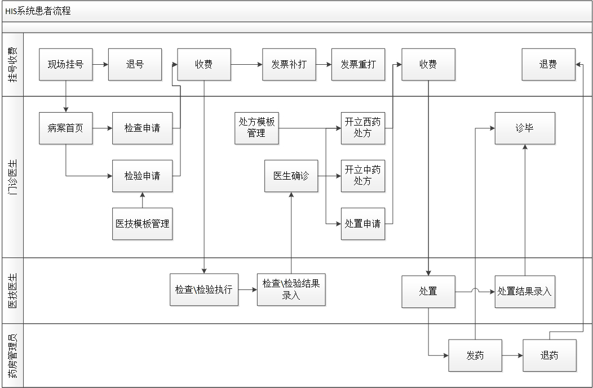
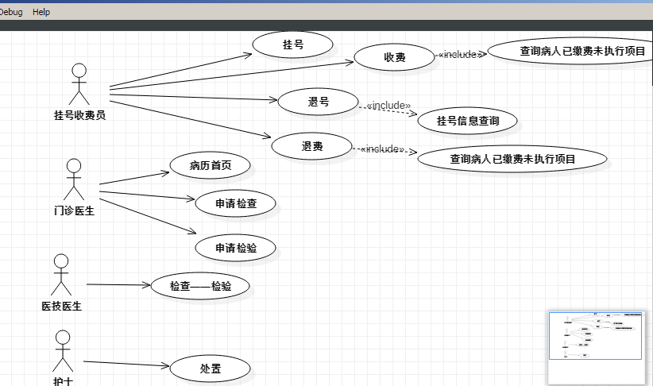

### 项目简介 
+ 项目名称：**东软云医院HIS系统**
+ HIS 英文全称 `hospital information system`，直译为中文就是医院信息系统。 
+ HIS 系统的主要功能按照数据流量、流向及处理过程分为临床诊疗、药品管理、经济管理、综合管理与统计分析等。
+ 临床诊疗部分主要以病人信息为核心，将整个病人诊疗过程作为主线，随着病人在医院中每一步诊疗活动的进行产生并处理各种诊疗数据与信息。整个诊疗活动主要由各种与诊疗有关的工作站来完成，并将这部分临床信息进行整理、处理、汇总、统计、分析等。此部分包括：门诊医生工作站、住院医生工作站、护士工作站、临床检验系统、输血管理系统、医学影像系统、手术室麻醉系统等。
+ 药品管理部分主要包括药品的管理与临床使用。在医院中药品从入库到出库，直到病人的使用，是一个比较复杂的流程，它贯穿病人的整个诊疗活动。这部分主要处理的是与药品有关的所有数据与信息。共分为两部分：
  + 一是基础部分，包括药库、药房及发药管理；
  + 一是临床部分，包括合理用药的各种审核及用药咨询与服务。

+ 经济管理部分属于医院信息系统中的最基础部分，它与医院中所有发生费用的部门有关，处理的是整个医院中各有关部门产生的费用数据，并将这些数据整理、汇总、传输到各自的相关部门，供各级部门分析、使用，并为医院的财务与经济收支情况服务。包括：门急诊挂号，门急诊划价收费，住院病人入、出、转，住院收费、物资、设备，财务与经济核算等。
+ 综合管理与统计分析部分主要包括病案的统计分析、管理，并将医院中的所有数据汇总、分析、综合处理供领导决策使用，包括病案管理、医疗统计、院长综合查询与分析、病人咨询服务。
+ 外部接口部分是随着社会的发展及各项改革的进行，必须考虑与社会上相关系统相联产生的需求。这部分提供了 HIS 与医疗保险系统、社区医疗系统、远程医疗咨询系统、数据上报系统等接口

### 项目启动
+ 导入数据库 `doc-sql/his.sql` ,数据库名是`his`
+ IDE中导入后端项目 `his`，
  + 下载依赖
  + 修改`src\main\resources\application.yml` 里的配置文件信息（数据库的连接信息） 
  + 运行`WebApp.java`里的`main`方法
+ 使用vscode打开前端项目`his-vue`，使用控制台运行 `npm run serve`
+ 在浏览器中输入即可访问`http://localhost:8080/`
+ 管理员默认密码 `admin` ，其他用户默认密码`123456` 

### 业务流程图

